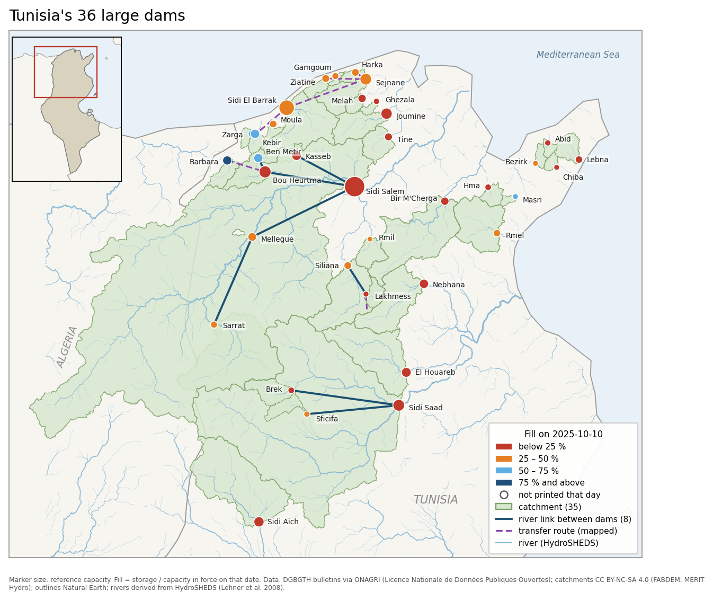
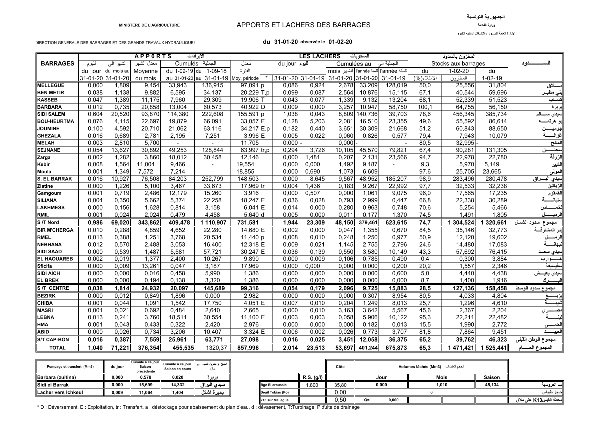
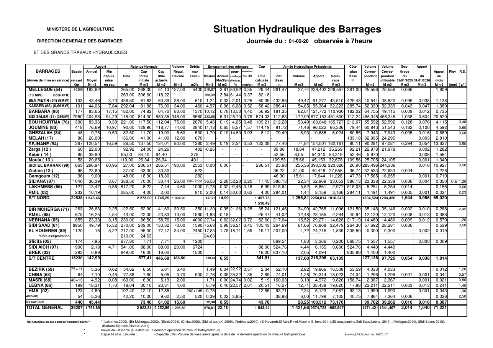
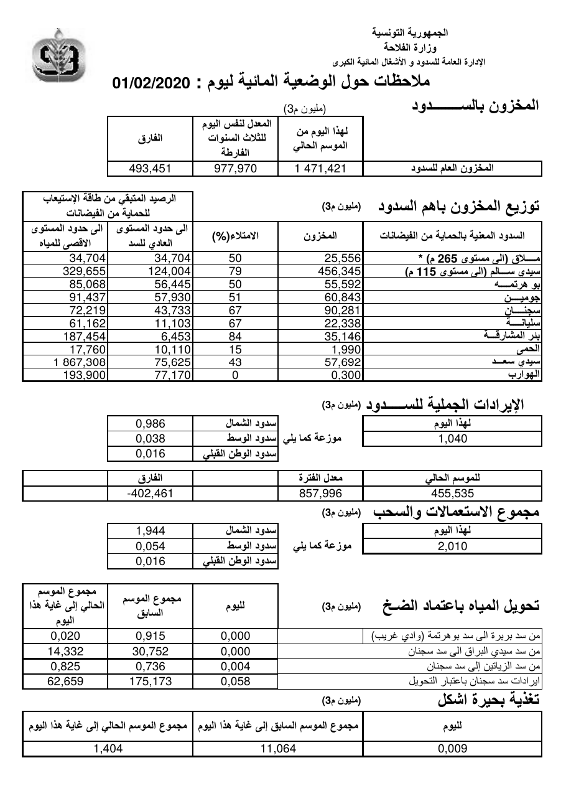
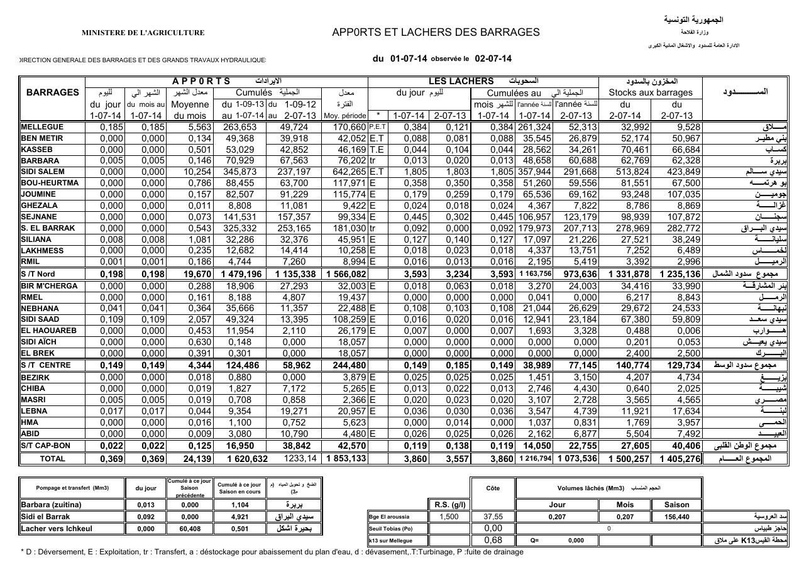
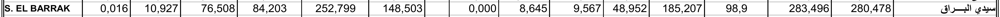
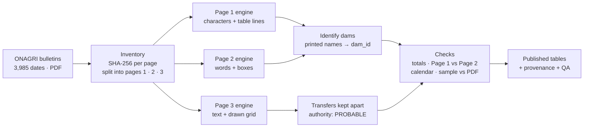

# DamLevels-Data

[](https://doi.org/10.5281/zenodo.23304326)

**How much water is in Tunisia's dams, day by day, since 2014?**

Every day the Tunisian Ministry of Agriculture publishes a three-page PDF bulletin on the country's large dams. The information is public, but it is locked in PDF tables: there is no spreadsheet, no API, and the layout has changed over the years. This repository turns eleven years of those bulletins into clean, documented tables you can open in Excel, pandas, R or QGIS, and every number in them can be traced back to the exact cell of the page it was read from.

| | |
|---|---|
| **Period** | 2 July 2014 to 10 October 2025 (3,985 bulletin dates, 11,927 PDF pages) |
| **Dams** | 36 large dams, each with a stable identifier (`dam_id`) |
| **Main table** | 129,390 daily storage values in million m³ (`data/storage.csv`) |
| **Also** | dam metadata and capacities, inter-dam transfers, catchments and river links (GIS), quality checks, and an ontology that defines every printed column |
| **Source** | DGBGTH bulletins *Situation des barrages*, published by [ONAGRI](https://www.onagri.nat.tn/Situation-des-barrages/fr/19) |
| **Method** | deterministic reading of the PDF text and drawn table lines — no OCR, no manual retyping |
| **Ask an AI** | a read-only MCP server lets Claude or any MCP-compatible assistant answer questions from the archive, with the source page of every number ([section 8](#8-ask-the-data-with-an-ai-assistant-mcp-server)) |



*The 36 dams on the latest bulletin date in the record, 10 October 2025. Together they held 649 million m³, 27 % of their capacity; 18 dams were below a quarter full and only Barbara was above 75 %. Most dams sit in the wetter north, in the Medjerda basin and along the northern coast. Dark blue lines are the natural river links between dams, dashed purple lines the artificial transfer routes. Open the dam layer as an interactive map: [`gis/vector/dams.geojson`](gis/vector/dams.geojson) (GitHub draws it on a map); the figure is produced by [`src/figures/make_readme_map.py`](src/figures/make_readme_map.py). Map and catchments: CC BY-NC-SA 4.0, derived from FABDEM v1-2 and MERIT Hydro. FABDEM is produced using Copernicus WorldDEM-30 © DLR e.V. 2010-2014 and © Airbus Defence and Space GmbH 2014-2018 provided under COPERNICUS by the European Union and ESA; all rights reserved.*

---

## Contents

1. [The source: a daily PDF bulletin](#1-the-source-a-daily-pdf-bulletin)
2. [From a printed cell to a row of data](#2-from-a-printed-cell-to-a-row-of-data)
3. [How the dataset was built](#3-how-the-dataset-was-built)
4. [Reading the numbers correctly](#4-reading-the-numbers-correctly)
5. [How the data was checked](#5-how-the-data-was-checked)
6. [Errors found in the bulletins themselves](#6-errors-found-in-the-bulletins-themselves)
7. [Quick start](#7-quick-start)
8. [Ask the data with an AI assistant (MCP server)](#8-ask-the-data-with-an-ai-assistant-mcp-server)
9. [What is in the repository](#9-what-is-in-the-repository)
10. [The ontology: a label on every number](#10-the-ontology-a-label-on-every-number)
11. [Limitations](#11-limitations)
12. [Licences and attribution](#12-licences-and-attribution)
13. [Citation and authors](#13-citation-and-authors)

---

## 1. The source: a daily PDF bulletin

Each bulletin has three pages. This is the bulletin of **1 February 2020**, one of the two sample bulletins included in [`sources/samples/`](sources/samples/).

**Page 1 — inflows, releases and stock, per dam.** This is the page the main storage table comes from. Note the header: *"du 31-01-20 observée le 01-02-20"* — flows describe the previous day, stocks describe the bulletin day (see [section 4](#4-reading-the-numbers-correctly)).



**Page 2 — levels, capacities, rain and a second copy of storage, inflow and release.** The duplicated values are used to cross-check Page 1.



**Page 3 — national totals, regions and water transfers between dams** (in Arabic).



**The layout changes over time.** In July 2014 Page 1 printed fewer dams and had no fill-percentage column; dams such as Sarrat only appear from April 2021. The extraction engines detect the layout of each page instead of assuming one.



Every bulletin used is listed in [`sources/manifest.csv`](sources/manifest.csv) with its link on the ONAGRI site and the SHA-256 fingerprint of each page, so anyone can download the same files and check that they are byte-identical.

## 2. From a printed cell to a row of data

Take one row of Page 1: **Sidi El Barrak** on the bulletin of 1 February 2020.



The second-last number, `283,496`, is the stock in the reservoir that morning, in million m³ with a French decimal comma. In [`data/storage.csv`](data/storage.csv) it becomes this row:

| Column | Value | Meaning |
|---|---|---|
| `dam_id` | `sidielbarrak` | stable identifier — join on this, never on the printed name |
| `date` | `2020-02-01` | bulletin date (stock is a state on this day) |
| `variable`, `value`, `unit` | `storage`, `283.496`, `Mm3` | the number, converted from `283,496` |
| `source_file` | `01-02-2020_1.pdf` | the page it was read from |
| `source_sha256` | `0bb40123…6032c5` | fingerprint of that exact PDF page |
| `page` | `1` | |
| `source_field` | `p1_stock_today_mm3` | which printed column |
| `engine_version` | `page1-authoritative-0.2.3` | which reader produced it |
| `lineage_id` | `P1LIN-d1da0054…` | link to the cell-level record below |
| `flag` | `ACCEPTED_PAGE1_OBSERVATION\|LINEAGE_LINKED` | status |

and its cell-level record in [`provenance/storage_lineage.csv`](provenance/storage_lineage.csv) keeps the evidence: physical column `14`, the cell's bounding box on the page, the raw printed characters `283,496`, the parse status `NUMERIC_PARSED`, and a link to the check against the printed regional subtotal.

This "passport" exists for every value. If a number looks wrong, you can open the original PDF, go to the cell, and see what was printed.

## 3. How the dataset was built



1. **Collect and fingerprint.** All bulletins were downloaded from ONAGRI, fingerprinted with SHA-256 and split into their three pages. Duplicates, backups and files with a date that disagrees with their content are kept in an inventory ([`sources/file_manifest.csv`](sources/file_manifest.csv)) rather than silently dropped.
2. **Read the pages.** Three deterministic engines read the characters of the PDF text layer and the lines drawn to make the tables. The Page 1 engine finds the column borders from the vertical rulings and assigns each character to its cell. Nothing is retyped and no OCR is used, so running an engine twice on the same file gives the same output. Page 1 yields 129,391 dam-day observations, Page 2 129,472, Page 3 274,183 facts.
3. **Identify the dams.** Dam names are printed in French and Arabic with varying spellings. A governed alias register maps every printed name to one stable `dam_id`.
4. **Keep the evidence.** Every value keeps its file, fingerprint, page, column, bounding box and raw printed text (1,896,094 Page 1 cells traced). Missing or unreadable cells stay missing; nothing is interpolated or forward-filled.
5. **Check.** Five complementary checks are applied wherever a value can be compared with something else ([section 5](#5-how-the-data-was-checked)).
6. **Package.** The results are published as long ("tidy") tables with a data dictionary, known issues, GIS layers and an ontology.

The extraction code is in [`src/extract/`](src/extract/); the packaging, contracts and checks are in [`src/`](src/) and [`qa/`](qa/).

## 4. Reading the numbers correctly

The column headings do not always mean what they seem to say. These rules are built into the data and written down in the [ontology](ontology/):

| Printed value | What it actually describes |
|---|---|
| Stock, level, fill % on the bulletin of day D | the state on **day D** |
| Inflow, release, transfer, evaporation on the bulletin of day D | the amount over **day D−1** |
| The two values under *Lâchers du jour* (release of the day) | the first is the release over **day D−1** (dated `31-01-20` on the 1 February 2020 bulletin); the second is the release on the **same day one year earlier** (`31-01-19`) — easy to mistake for a current value |
| Month-to-date totals | from the first day of the month of D−1 — they restart on the bulletin of the **2nd** of the month |
| Season totals | from **1 September** — they restart on the bulletin of 2 September |
| Capacity | the printed *useful capacity at the last survey*; storage can exceed it during floods |

## 5. How the data was checked

No value is trusted on its own. Five complementary checks compare values with something independent. Each check applies only where its comparison exists, so each has its own denominator: not every value goes through every check. For example, 44,770 storage values have no printed fill % to compare with, and the direct re-reading of the PDF is a random sample (800 Page 1, 800 Page 2 and 792 verifiable Page 3 cells), not the whole record.

| Check | Rule | Result |
|---|---|---|
| Against the printed totals | the dams of each page must add up to the printed regional and national totals (within rounding) | national total: 3,965 / 3,967 bulletins |
| Against the other page | storage is printed on both Page 1 and Page 2; the two must be equal | 128,995 / 128,996 pairs equal |
| Against the calendar | today's running total − yesterday's = today's flow (±0.0015 Mm³) | 99.48 % of 122,957 monthly inflow steps |
| Against the fill % | printed fill = storage / capacity, allowing for the rounding of all three numbers | 84,470 / 84,471 rows |
| Against the original PDF | a random sample of cells re-read directly from the page | 2,392 / 2,392 sampled cells correct (800 + 800 + 792) |

All results, with every exception row, are in [`qa/kpi/results/`](qa/kpi/results/) and can be recomputed with `python qa/kpi/run_kpis.py`. A quick check of your own: on 1 February 2020 the 33 dams on the page add up to **1,471.419 Mm³**; the bulletin prints a total of **1 471,421** — the 0.002 difference is rounding.

## 6. Errors found in the bulletins themselves

Some problems are in the source, not in the extraction. They are documented and **never silently repaired**:

- **Swapped rows.** From 2017 to 2021 the season-to-date inflows of Ziatine and Gamgoum are printed in each other's rows (checked in `13-1-2018_1.pdf`). The values are published as printed.
- **One fill mismatch.** Masri, 9 February 2022: printed fill 44.9 %, computed 43.87 %.
- **Two national totals that do not add up**: 30 December 2017 and 9 February 2022.
- **Mis-dated files.** Two Page 3 files of September 2019 carry the wrong date in their filename; they were re-dated from their content and fingerprint.
- **Undocumented column.** Page 2 has a column "R.S." whose meaning the publisher does not explain; it is not interpreted.

The full list is in [`docs/known_issues.md`](docs/known_issues.md).

## 7. Quick start

Download the repository (green **Code** button → *Download ZIP*) or `git clone`, then:

```python
import pandas as pd

storage = pd.read_csv("data/storage.csv", parse_dates=["date"])
dams = pd.read_csv("data/dams.csv")
df = storage.merge(dams[["dam_id", "name_fr", "reference_capacity_mm3"]], on="dam_id")

# One dam over a few days
sidi = df[df.dam_id == "sidielbarrak"].set_index("date")["value"].sort_index()
print(sidi.loc["2020-01-29":"2020-02-03"])

# Total storage of all printed dams on one day
print(df.groupby("date")["value"].sum().loc["2020-02-01"])   # 1471.419
```

```
date
2020-01-29    283.496
2020-01-30    283.496
2020-01-31    283.496
2020-02-01    283.496
2020-02-02    283.496
2020-02-03    283.798
```

Good practice:

- **Join on `dam_id`**, never on dam names (they vary between bulletins and between French and Arabic).
- **Missing days are gaps.** If a dam has no row for a date, the bulletin did not give a usable value; do not assume zero.
- **Not every dam is printed every day.** Some dams were added to the bulletin later (Melah 2019, Tine 2020, Harka and Sarrat 2021).
- Parquet versions of the large tables are in [`data/parquet/`](data/parquet/).

Prefer to ask in plain language? See [section 8](#8-ask-the-data-with-an-ai-assistant-mcp-server).

For maps, open [`gis/project/DamLevels-Data.qgs`](gis/project/DamLevels-Data.qgs) in QGIS 3.44+, or load the GeoJSON files in [`gis/vector/`](gis/vector/) in any GIS tool. Clicking a `.geojson` file on GitHub shows it on an interactive map.

## 8. Ask the data with an AI assistant (MCP server)

You don't need to write code to use the archive. The repository includes a read-only **[MCP server](mcp_server/)** — a small program that plugs the dataset into AI assistants that support the [Model Context Protocol](https://modelcontextprotocol.io), such as Claude Desktop and Claude Code. You ask a question in English, French or Arabic; the assistant looks the answer up in the published tables instead of guessing, and can show you the bulletin page each number came from.

**Questions you can ask**

- *How full was Sidi Salem on 10 October 2025, and where does that number come from?*
- *How much water did Tunisia's dams hold on 10 October each year since 2014?*
- *Compare Sidi El Barrak this winter with the same days last year.*
- *What does الإيرادات mean in the bulletin, and which day does it refer to?*
- *Which transfers between dams were reported in February 2020?*

**What an answer looks like.** Asked about Sidi Salem on 10 October 2025, the server returns:

| | |
|---|---|
| Storage | **137.196 million m³** |
| Capacity in force that day | 580.35 million m³ |
| Fill | **23.6 %** (the bulletin itself prints 23.6 %) |
| Source | [`BARRAGES-10-10-2025.pdf`](https://www.onagri.nat.tn/uploads/barrages/BARRAGES-10-10-2025.pdf), page 1, printed as `137,196` |

and for the national question, total storage on 10 October of each year:

| 2014 | 2015 | 2016 | 2017 | 2018 | 2019 | 2020 | 2021 | 2022 | 2023 | 2024 | 2025 |
|---:|---:|---:|---:|---:|---:|---:|---:|---:|---:|---:|---:|
| 1,179 | 1,139 | 660 | 586 | 896 | 1,393 | 966 | 669 | 736 | 579 | 501 | 649 |

*Million m³, sum of the dams printed that day (26 dams in 2014, all 36 from 2021), so early years are not fully comparable.*

**Why answers can be trusted.** The rules of the data are built into the server, so the assistant cannot get them wrong:

- dates after 10 October 2025 are refused (`OUTSIDE_RECORD`) — nothing is ever estimated;
- a missing day is reported as missing, never as zero and never replaced by a neighbouring day;
- flows are dated to the day before the bulletin; fill uses the capacity in force on that date;
- transfers are always marked as less certain (`PROBABLE`);
- every answer carries the source attribution and any caveats.

**Tools available to the assistant:** `find_dam` (French or Arabic names), `list_dams`, `get_storage`, `get_fill`, `national_storage`, `compare_years`, `get_source`, `get_transfers`, `describe_variable` (meanings from the [ontology](ontology/)), `dataset_info`.

**Set it up** (Python 3.11+, from a clone of this repository):

```bash
pip install -e "mcp_server[ontology]"
claude mcp add damlevels -- python -m damlevels_mcp      # Claude Code
```

For Claude Desktop, add this to `claude_desktop_config.json`:

```json
{ "mcpServers": { "damlevels": { "command": "python", "args": ["-m", "damlevels_mcp"] } } }
```

Full documentation, all tools and their tests: [`mcp_server/README.md`](mcp_server/README.md).

## 9. What is in the repository

| Folder / file | What it contains |
|---|---|
| [`data/storage.csv`](data/storage.csv) | 129,390 daily storage values (Mm³) with full provenance |
| [`data/dams.csv`](data/dams.csv) | 36 dams: `dam_id`, French and Arabic names, coordinates, reference capacity |
| [`data/capacity_history.csv`](data/capacity_history.csv) | capacity regimes with the dates they apply |
| [`data/transfers.csv`](data/transfers.csv) | 47,556 inter-dam transfer facts from Page 3 (authority `PROBABLE`) |
| [`gis/`](gis/) | dams, 35 catchments, 34 incremental catchments, 8 natural river links, 10 transfer routes (GeoJSON, EPSG:4326), styles and a QGIS project |
| [`sources/`](sources/) | bulletin manifest with ONAGRI links and fingerprints, two sample bulletins |
| [`provenance/`](provenance/) | cell-level lineage, missing values, change log |
| [`qa/`](qa/) | quality indicators ([`qa/kpi/`](qa/kpi/)), extraction audits, consistency tables |
| [`ontology/`](ontology/) | DamLevels Ontology (DLO 0.3) with example queries |
| [`docs/`](docs/) | [data dictionary](docs/data_dictionary.md), [known issues](docs/known_issues.md), [GIS notes](docs/gis.md), [engineering notes](docs/engineering_notes.md) |
| [`src/`](src/), [`tests/`](tests/) | extraction engines, contracts, checks and builders |
| [`mcp_server/`](mcp_server/) | read-only MCP server for AI assistants |
| [`datapackage.json`](datapackage.json) | machine-readable description of every table and field ([Frictionless Data](https://frictionlessdata.io/)) |

## 10. The ontology: a label on every number

A spreadsheet can hold `8,645`, but not say what it is. The **DamLevels Ontology (DLO 0.3)** in [`ontology/`](ontology/) maps the 84 printed columns to 33 concepts and 16 time rules, so each value knows *what* was measured, *where*, *for which day*, in *which unit*, and *which page* it came from. For example, `8,645` in the Sidi El Barrak row above becomes: *released water volume · Sidi El Barrak reservoir · 31 January 2019 · million m³ · a reference value from one year earlier*.

It is built on W3C/OGC standards (SOSA, OWL-Time, QUDT, PROV, SKOS) and can be opened in Protégé or queried with SPARQL; see [`ontology/README.md`](ontology/README.md) for example queries and their output.

## 11. Limitations

- **Page 3 (transfers) is the weakest source.** Its facts are published with authority `PROBABLE`; two transfer endpoints are only candidate matches, and their dates follow the bulletin rather than the verified day (see [known issues](docs/known_issues.md)).
- **Some metadata is incomplete.** Basin names are given for 6 dams only; Arabic names for part of the roster.
- **Six bulletins have no ONAGRI link** in the current listing (2019-09-28, 2020-06-01, 2022-07-08, 2024-08-24 to 26).
- **Catchments:** Mellègue has no accepted catchment; two incremental catchments are special cases (see [GIS notes](docs/gis.md)).
- **Not official statistics.** This is an independent reconstruction from public bulletins. No forecasting model is included or claimed.

## 12. Licences and attribution

| What | Licence |
|---|---|
| Source values (DGBGTH bulletins, published by ONAGRI) | [Licence Nationale de Données Publiques Ouvertes](https://www.data.gov.tn/fr/licences-de-r%C3%A9utilisation-des-donn%C3%A9es-publiques-ouvertes/) — cite the producer and the date |
| Tables, QA, provenance, documentation, ontology, dam points, transfer network, styles, QGIS project | [CC BY 4.0](https://creativecommons.org/licenses/by/4.0/) |
| `gis/vector/catchments*.geojson`, `natural_network.geojson` (derived from FABDEM and MERIT Hydro), and the overview map `docs/img/map_dams.png` | [CC BY-NC-SA 4.0](https://creativecommons.org/licenses/by-nc-sa/4.0/) — non-commercial |
| Country outlines in `gis/context/` | Natural Earth, public domain |
| Code (`src/`, `tests/`, `qa/kpi/*.py`, `mcp_server/`) | [MIT](LICENSE) |

When you reuse the data, please include:

> Source: DGBGTH, Ministère de l'Agriculture, des Ressources Hydrauliques et de la Pêche (Tunisie), bulletins "Situation des barrages" published by ONAGRI, 2014-07-02 to 2025-10-10. Licence Nationale de Données Publiques Ouvertes. Extracted and restructured by DamLevels-Data.

Details are in [`LICENSE-DATA`](LICENSE-DATA). The Page 3 extractor imports PyMuPDF (AGPL-3.0); distributing a build that bundles PyMuPDF must follow the AGPL.

## 13. Citation and authors

Please cite this repository using [`CITATION.cff`](CITATION.cff). Every release is archived on Zenodo: DOI [10.5281/zenodo.23304326](https://doi.org/10.5281/zenodo.23304326) always points to the latest version; each version also has its own DOI on that page.

**Authors:** Mohamed Hamza Nasfi, Soura Boulares, Tarek Gasmi.

The work was carried out as a Licence capstone project at MUST University, within the DataDoIt × MUST University incubator, for [TanitData](https://github.com/tanitdata), an open-data studio based in Tunisia. The bulletins are produced by the Direction Générale des Barrages et des Grands Travaux Hydrauliques (DGBGTH) and published by the Observatoire National de l'Agriculture (ONAGRI).

Rebuilding the QA from the original bulletins and the full engineering record are described in [`docs/engineering_notes.md`](docs/engineering_notes.md) and [`CHANGELOG.md`](CHANGELOG.md).
